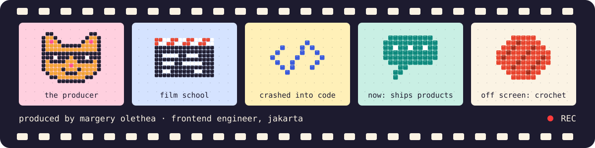

  
  
  
  

Film graduate who crashed into code and never left. I still think in scenes: who is the person, what is annoying them, how does it end well. Then I build the ending.

   
  colour key (also my stack)

### 🎬 Now showing

The source for these is private. Ask me and I will happily walk you through any of them.

**The bot that answers so I don't have to** · Next.js, TypeScript, MCP, Redis · solo 
*Scene: customers of mulaibelajarai.com ask the same question on WhatsApp for the fortieth time.*

- It answers from a knowledge base I wrote, so it never makes things up.
- It looks up each customer's registration through an MCP server I built, so the answer is about *them*.
- When a human jumps in, it goes quiet and takes notes. Overnight it learns from them.
- 1,149 tests, because I do not trust it either.

**The reader that never gets tired** · Python · solo 
*Scene: it is early, and someone needs one good video idea. Again.*

- It reads news feeds, Google Trends, Reddit, Hacker News and competitor channels, and folds the same story told five ways into one.
- Every story faces a judge with six gates. The rules live in a plain document, so the taste can change without touching code.
- Survivors get a title, a hook and three thumbnail directions. Ask, and it writes the full storyline.
- Every approve, reject and edit teaches it what "good" means here.

**The scriptwriter who is up before you** · Python, Telegram, Notion · solo 
*Scene: a daily short video needs a topic and a script before the day has properly started.*

- At 08:00 it sends four trending topics to Telegram, and remembers two weeks of them so it never pitches the same story twice.
- Tap one and it writes a 160 to 200 word script in the creator's voice. Hand it an old transcript and it writes an original from that.
- It marks its own homework: length, required phrases, banned words. A fail gets one rewrite.
- 665 tests.

### 🎞️ Back catalogue

Open source, free to watch.

- **[Photo Backup Checker](https://github.com/MargeryOlethea/photo-backup-checker)** · Swift, macOS "Are my iPhone photos actually backed up?" Now the answer takes one look.
- **[Cosmoscope](https://github.com/MargeryOlethea/Cosmoscope)** · React, TypeScript, Vite Cosmos Hub blocks, validators and proposals in one calm place.
- **[Wallet Integration](https://github.com/MargeryOlethea/wallet-integration)** · Next.js, TypeScript, CosmJS · [live](https://wallet-integration-two.vercel.app) Stake, claim and vote on three testnets from one wallet screen.
- **[RightTrack](https://github.com/MargeryOlethea/RightTrack)** · React, Express, PostgreSQL Receipt photos in, budget out. Built in four days.

### 📈 The dailies

  

<b>🗑️ Deleted scenes</b>

 

Takes that did not make the final cut, kept for the blooper reel.

- **[Lactalink](https://github.com/MargeryOlethea/Lactalink)**: a bootcamp final project built with two teammates. A mobile prototype for matching breastmilk donors and recipients.
- **[Trun Ecommerce](https://github.com/MargeryOlethea/Trun-Ecommerce)**: a full-stack shop prototype in Next.js and MongoDB.

